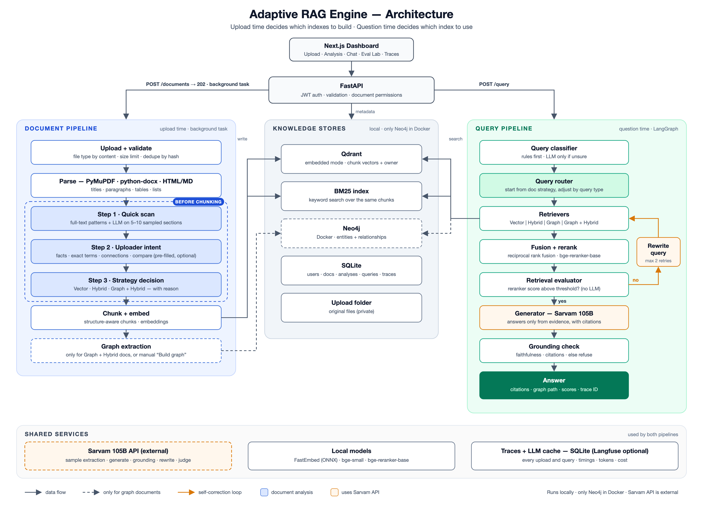

# PRD: Adaptive RAG Engine — Enterprise Knowledge Intelligence Platform

> Analyze the knowledge **before** indexing it, pick the right retrieval architecture, and prove the choice with measured results.

| Field | Value |
|---|---|
| Owner | Nandhini |
| Status | Draft v4 — lean v1 scope, approved to build |
| Last updated | 2026-10-07 |
| Type | AI portfolio project |
| Primary goal | Demonstrate adaptive RAG architecture, self-correction, and measured evaluation — built fast, on a laptop |

**Core idea:** Analyze → Decide → Retrieve → Evaluate → Correct → Answer

**v4 changes:** fewer LLM calls per query (rule-first classifier, reranker-score relevance gate); LLM response cache; cheaper deterministic evaluation on a generated demo corpus; no Unstructured; BM25 via LangChain rebuilt from SQLite.

**v3 changes:** lean v1. No PyTorch: models run on FastEmbed (ONNX Runtime). LangChain for standard RAG parts, LangGraph for the adaptive flow. Only **one Docker container (Neo4j)**. Removed Redis, Celery, PostgreSQL, the Qdrant server, and self-hosted Langfuse; cut refresh tokens, roles, sharing, and versioning. These move to the v2 roadmap (Section 21).

---

## 1. Problem

- Most RAG systems push every document through one fixed pipeline: chunk → embed → vector DB → retrieve → LLM.
- That works for simple knowledge bases but struggles when documents contain:
  - complex relationships between entities and long-range dependencies
  - cross-references, tables, and mixed document types
  - questions that need multi-hop reasoning
- Using GraphRAG for everything adds cost, latency, and complexity where it is not needed.
- Fully chunking and extracting a document just to decide how to index it is too costly.

**Core question:** how can a RAG system cheaply decide the right retrieval architecture for a document, and then for each query?

## 2. Solution

- **Two decisions, at two times:**
  - **Upload time — what to build.** A cheap scan plus one question to the uploader decides whether a graph is worth building on top of normal RAG.
  - **Question time — what to use.** The query router picks a retrieval mode from what was built.
- **Three document strategies** (what gets built):

| Document strategy | Qdrant (vector) | BM25 (keyword) | Neo4j (graph) |
|---|---|---|---|
| Vector | ✓ | | |
| Hybrid | ✓ | ✓ | |
| Graph + Hybrid | ✓ | ✓ | ✓ |

- **Four retrieval modes** (what a query uses): Vector, Hybrid, Graph, Graph + Hybrid.
- **Self-correcting loop:** evaluate retrieval, rewrite the query when relevance is low, rerank evidence.
- **Grounding check:** verify the answer against sources; refuse when evidence is insufficient.
- **Evaluation Lab:** compare modes on quality, latency, and token cost with real measured numbers.

## 3. Goals

| # | Goal | Measured by |
|---|---|---|
| G1 | Correct document strategy | Chosen strategy matches the best-scoring one for ≥ 4 of 5 demo documents |
| G2 | Correct query routing | Router picks the best-scoring available mode on ≥ 80% of labeled eval queries |
| G3 | Better retrieval than a fixed vector baseline | Higher context relevance and recall on relationship and multi-hop queries |
| G4 | Grounded answers | Faithfulness ≥ 0.85 (LLM judge); insufficient-evidence response instead of guessing |
| G5 | Self-correction pays off | Measurable relevance gain on queries that triggered a rewrite |
| G6 | Cheap analysis | Upload analysis uses ≤ 10% of the LLM tokens a full extraction would |
| G7 | Explainable answers | Every answer shows evidence chunks, sections, and graph paths used |
| G8 | Runs light | Full stack runs on a 16 GB Intel laptop with < 8 GB used by the app |

## 4. Non-goals (v1)

- No cloud deployment; runs locally.
- No Redis, Celery, PostgreSQL, or Qdrant server (see Section 21 for v2).
- No refresh tokens, roles, document sharing, or document versioning.
- No distributed search; BM25 runs in-process.
- No fine-tuning.
- No connectors (Slack, Confluence, Drive); uploads only.

## 5. Users and user stories

**Primary users (demo):** recruiters and interviewers; developers reading the repo.
**Persona in the product:** knowledge workers searching company documents; ML engineers comparing retrieval modes.

| ID | As a… | I want to… | So that… |
|---|---|---|---|
| US1 | User | upload a document and see its analysis | I understand how it will be indexed |
| US2 | User | say what I'll ask about the document | indexing fits how I'll use it |
| US3 | User | ask a simple fact question | I get a fast, cited answer |
| US4 | User | ask "What services depend on Auth Service?" | I get an answer built from relationships |
| US5 | User | see "Why did I get this answer?" | I can trust and verify the answer |
| US6 | User | get told when evidence is missing | I am not misled |
| US7 | User | see only my own documents | my data stays private |
| US8 | ML engineer | compare modes on an eval set | I can justify routing with data |
| US9 | Developer | start the project with a few commands | I can reproduce it |

## 6. Example use cases

### UC1 — Simple document

Upload `Employee Handbook.pdf`.

```text
Quick scan:     Relationship words low · Cross-refs low · Tables few
Uploader picks: "Look up facts or policies"
Decision:       Hybrid  (no graph built)
```

Ask: *"How many days of annual leave are employees entitled to?"* → **Hybrid**.

### UC2 — Relationship-heavy document

Upload software architecture documentation.

```text
Quick scan:     Relationship words high · Cross-refs high · IDs medium
                Est. relationship density (8 sampled sections): high
Uploader picks: "How things connect" + "Find exact terms"
Decision:       Graph + Hybrid  (Qdrant + BM25 + Neo4j built)
```

Ask: *"What port does the Auth Service use?"* → **Hybrid**.
Ask: *"What services depend on the Authentication Service?"* → **Graph**.

### UC3 — Poor first retrieval

Ask: *"Which services are affected by the payment migration?"*

```text
Retrieve → Evaluate (relevance 0.42, below threshold)
        → Rewrite query → Retrieve again → Rerank → Grounded answer
```

Numbers above are illustrative. The app must show real computed values.

## 7. Functional requirements

### 7.1 Ingestion

- **FR1** Accept PDF, DOCX, TXT, Markdown, and HTML; validate type by content; reject others.
- **FR2** Enforce a configurable size limit (default 50 MB).
- **FR3** Return `202 Accepted` with a document ID; process with a FastAPI background task.
- **FR4** Store status (`scanning`, `awaiting_intent`, `indexing`, `ready`, `failed`), percent progress, and stage in SQLite; the UI polls it.
- **FR5** Parse once into typed elements (titles, paragraphs, tables, lists) with light parsers: PyMuPDF for PDF (incl. table detection), python-docx for DOCX, BeautifulSoup for HTML, markdown-it for Markdown, plain read for TXT. No Unstructured.
- **FR6** Store original files in a local `data/uploads/` folder, served only through authorized API calls.
- **FR7** Re-uploading the same file (same hash) does not duplicate data.

### 7.2 Document analysis (before chunking)

The decision is made **without chunking or embedding the whole document**. Only parsing, text pattern checks, and an LLM pass over a small sample happen before it.

```text
Parse ─▶ Step 1: Quick scan ─▶ Step 2: Uploader intent ─▶ Step 3: Decision ─▶ Chunk + index
          (full-text patterns     (one question,              (scan + intent
           + LLM on a sample)      pre-filled from scan)       → strategy)
```

#### Step 1 — Quick scan

- **FR8** Count structure from parser elements: pages, sections, headings, tables, lists, links.
- **FR9** Run cheap pattern checks over the full text:
  - cross-reference phrases ("see Section 4.2", "as defined in", "refer to")
  - relationship phrases ("depends on", "calls", "reports to", "owned by", "part of", "integrates with")
  - identifiers (codes, IDs, version numbers, acronyms, product names)
- **FR10** Sample 5–10 sections spread across the document, weighted toward sections with the most relationship phrases. Send only the sample to the LLM to extract entities and relationships.
- **FR11** Estimate document-wide signals and store them as a document profile:

| Signal | How it is measured | Points to |
|---|---|---|
| Relationship density | Relationships per entity in the sample | Graph if high |
| Entity repetition | Share of sampled entities appearing in 3+ sections (string match over full text) | Graph if high |
| Cross-reference rate | Cross-reference phrases per 1,000 words | Graph if high |
| Relationship phrase rate | Relationship phrases per 1,000 words | Graph if high |
| Identifier density | Identifiers per 1,000 words | Hybrid if high |
| Table share | Share of content inside tables | Hybrid if high |
| Size | Page and word count | Vector only if small and plain |

- **FR12** From the profile, compute suggested intents for Step 2.

#### Step 2 — Uploader intent

- **FR13** Ask: *"What will you mostly ask about this document?"* (multi-select, pre-filled):
  - `facts` — look up facts or policies
  - `exact_terms` — find exact terms, IDs, or codes
  - `connections` — understand how things connect or depend on each other
  - `compare` — compare or summarize across sections
- **FR14** Optional. Intents can also be sent with the upload. If skipped, the scan alone decides.

#### Step 3 — Strategy decision

- **FR15** Combine scan and intent with this table. Store the strategy, confidence, and a plain-language reason shown in the UI.

| Scan says | Uploader intent | Strategy | Notes |
|---|---|---|---|
| Small, plain prose; few IDs | `facts` | Vector | Cheapest path |
| Few relationships | `facts` and/or `exact_terms` | Hybrid | Default for most documents |
| Few relationships | `connections` or `compare` | Hybrid | UI warns the document has few relationships; graph can be built manually |
| Many relationships | `connections` or `compare` | Graph + Hybrid | Full graph extraction runs |
| Many relationships | `facts` and/or `exact_terms` only | Hybrid | Marked `graph_candidate`; graph recommended when a relationship question arrives |
| Many relationships | skipped | Graph + Hybrid | Scan alone decides |

- **FR16** Thresholds and weights live in config and are tuned against the eval set. Starting values:

```text
many_relationships = relationship_density > 1.5
                     OR (cross_ref_rate > 2 AND relationship_phrase_rate > 3)
small_plain        = pages < 10 AND identifier_density < 1 AND table_share < 5%
```

### 7.3 Indexing (after the decision)

- **FR17** Chunk structure-aware: respect section boundaries; keep tables whole.
- **FR18** Embed chunks and store them in Qdrant (embedded local mode) with document, section, and owner metadata. Save chunk text in SQLite; build LangChain's BM25 retriever over the same chunks (skipped for Vector documents) and rebuild it from SQLite on server start.
- **FR19** Run full entity and relationship extraction into Neo4j **only** for Graph + Hybrid documents. Each edge links back to its source chunk.
- **FR20** "Build index" action for any document (manual upgrade): add the keyword index, the graph, or both. Triggered only by the user, usually from a recommendation (FR26). After it finishes, the same question can be re-asked with the better mode.
- **FR21** "Build all indexes" option, so the Evaluation Lab can compare every mode.

### 7.4 Retrieval modes

| Mode | Flow | Best for |
|---|---|---|
| Vector | Query → embedding → Qdrant → top-k chunks | Simple facts, semantic similarity |
| Hybrid | BM25 + vector → reciprocal rank fusion → rerank | Exact terms, product names, IDs |
| Graph | Entity detection → Neo4j traversal → related entities → supporting chunks | Dependencies, ownership, multi-hop |
| Graph + Hybrid | Graph traversal + BM25 + vector → fusion → rerank | Comparison and complex multi-hop |

- **FR22** All four modes behind one `Retriever` interface.
- **FR23** Rerank fused candidates with `bge-reranker-base` via FastEmbed.

### 7.5 Query routing

- **FR24** Classify each query as fact lookup, semantic, keyword-heavy, relationship, multi-hop, comparison, or aggregation. **Rules first** (keywords like "depends on", "compare", "between", quoted IDs, known entity names); call the LLM only when rules are not confident.
- **FR25** Work out the **ideal mode** for the query type:
  - fact lookup / semantic → Vector
  - keyword-heavy → Hybrid
  - relationship / multi-hop → Graph
  - comparison / aggregation → Graph + Hybrid
- **FR26** **Use only what was built for the document.** Retrieval runs only on the indexes that exist for that document; the system never searches for or switches to other options.
  - If the ideal mode is available → use it.
  - If not → answer with the document's own strategy (Vector → Vector; Hybrid → Hybrid), and attach a **recommendation**: which mode would work better for this question, why, and the index to build (e.g. *"GraphRAG would be more effective for this relationship question. Build the graph for this document?"*).
  - The user accepts with one click (FR20). Nothing is built without the user's action.
  - Every recommendation is recorded, so the UI can show how often a document's questions needed a missing index.

| Built for document | Ideal mode | Used | Recommendation |
|---|---|---|---|
| Vector | Vector | Vector | — |
| Vector | Hybrid | Vector | Build keyword index |
| Vector | Graph / Graph + Hybrid | Vector | Build keyword index + graph |
| Hybrid | Vector / Hybrid | Ideal mode | — |
| Hybrid | Graph / Graph + Hybrid | Hybrid | Build graph |
| Graph + Hybrid | any | Ideal mode | — |
- **FR27** Manual mode override (for the Evaluation Lab and debugging).

### 7.6 Self-correcting retrieval

- **FR28** Score context relevance from the **reranker scores** (top-1 and mean of top-3, normalized to 0–1). No LLM call.
- **FR29** If below a configurable threshold, rewrite the query and retrieve again.
- **FR30** Stop after `MAX_RETRIES` (default 2).
- **FR31** If evidence is still insufficient, return: *"I don't have enough evidence in the knowledge base to answer this reliably."*

```text
Query → Classify → Route → Retrieve → Rerank → Evaluate relevance
                             ▲                        │
                             │                 relevant? ── yes ──▶ Generate
                             │                        │ no
                             └──── Rewrite query ◀────┘  (until MAX_RETRIES,
                                                          then insufficient-evidence)
```

### 7.7 Answer generation and grounding

- **FR32** Answer only from retrieved evidence, with inline citations to chunk and section.
- **FR33** After generation, one LLM call checks faithfulness and citation correctness (each claim supported by its cited chunk).
- **FR34** If grounding fails, regenerate once with stricter instructions, then fall back to the insufficient-evidence response.
- **FR35** Store all scores with the query record.

### 7.8 Explainable retrieval

- **FR36** "Why did I get this answer?" panel: document strategy and reason, query type, ideal mode vs mode used, any recommendation with its "Build index" button, routing decision, rewrites, evidence documents and sections, graph paths, scores, and per-stage timings.

```text
Answer
  └── Evidence
       ├── Document A → Section 4.2
       ├── Document B → Section 8
       └── Graph path: Service A → Auth Service → User Service
```

### 7.9 Evaluation Lab

- **FR37** Run a labeled eval set through every mode and the router.
- **FR38** Report per mode and per query type: Hit@5, Recall@5, and MRR against gold chunks (no LLM); faithfulness and answer correctness via LLM judge; latency (p50/p95), tokens, and cost.
- **FR39** Show results as tables and charts; export Markdown + JSON.
- **FR40** Report document strategy accuracy and router accuracy.

Illustrative layout (real values come from runs):

| Metric | Vector | Hybrid | Graph | Graph + Hybrid | Router |
|---|---:|---:|---:|---:|---:|
| Hit@5 | — | — | — | — | — |
| Recall@5 | — | — | — | — | — |
| Faithfulness | — | — | — | — | — |
| Latency p95 | — | — | — | — | — |
| Tokens / query | — | — | — | — | — |

### 7.10 Authentication

- **FR41** Register and log in with email and password (bcrypt hashing); one JWT access token.
- **FR42** Every document, chunk, and graph node carries `owner_id`; every retrieval filters by it.

### 7.11 Observability

- **FR43** Record per-stage timings, tokens (including reasoning tokens), cost in INR, scores, retries, and mode for every query and upload in SQLite; the UI reads these.
- **FR44** Send the same traces to Langfuse Cloud (free tier) when keys are set; skip silently when not.
- **FR45** Structured JSON logs with request IDs.

### 7.12 Cost controls

- **FR46** Cache every LLM response in SQLite, keyed by a hash of model, messages, and parameters. Repeat calls in development and evaluation cost nothing. A `--no-cache` flag bypasses it.

## 8. Non-functional requirements

| Area | Requirement |
|---|---|
| Latency | p95 < 6 s for Vector/Hybrid, < 12 s for Graph + Hybrid with one retry (Intel i7 laptop, CPU models) |
| Upload analysis | Scan + decision for a 100-page PDF in < 60 s |
| Memory | App uses < 8 GB total (Neo4j + API + web) |
| Cost | Average < ₹0.50 per query; full eval run < ₹200, near ₹0 on cached re-runs (Sarvam credits) |
| Reliability | Timeouts and retries with backoff on LLM and DB calls; Sarvam rate limits handled |
| Errors | Clear errors for invalid files, parse, LLM, embedding, DB, and retrieval failures |
| Reproducibility | `make setup && make up && make dev` on a fresh machine |
| Portability | LLM provider, vector store, and metadata DB behind interfaces; swaps need no pipeline changes |

## 9. Security requirements

- Hashed passwords and JWT auth.
- Pydantic validation on every input; file type checked by content; size limits.
- Owner isolation in every store.
- Secrets only from `.env` (`SARVAM_API_KEY`, `NEO4J_PASSWORD`, `JWT_SECRET`); `.env` git-ignored; `.env.example` committed.
- Secret scanning in CI.
- Neo4j port bound to `localhost` only.

## 10. Architecture

### 10.1 High-level diagram



Source: [docs/architecture.svg](docs/architecture.svg).

**What runs where:**

| Piece | Runs as |
|---|---|
| Next.js dashboard | `npm run dev` (native) |
| FastAPI + background tasks + models + Qdrant (embedded) + BM25 + SQLite | `uv run` (native, one process) |
| Neo4j | Docker — the only container |
| Sarvam 105B | External API |
| Langfuse | External, optional (free tier) |

### 10.2 Components

| Component | Responsibility |
|---|---|
| `api` | FastAPI routes, validation, auth dependency |
| `auth` | Password hashing, JWT |
| `ingest.parser` | PyMuPDF, python-docx, BeautifulSoup, markdown-it parsing |
| `ingest.scanner` | Structure counts and pattern checks (Step 1) |
| `ingest.sampler` | Section sampling and LLM extraction on the sample (Step 1) |
| `ingest.intent` | Suggested and uploader intents (Step 2) |
| `ingest.selector` | Decision table, confidence, reason (Step 3) |
| `ingest.extractor` | Full graph extraction |
| `ingest.chunker` | Structure-aware chunking |
| `ingest.jobs` | Background task orchestration and progress |
| `store.vector_store` | All Qdrant calls (embedded mode) |
| `store.bm25_store` | LangChain BM25 retriever per document, rebuilt from SQLite chunks |
| `store.graph_store` | All Neo4j calls (single place for Cypher) |
| `store.db` | SQLAlchemy models on SQLite |
| `store.files` | Upload folder |
| `models.embedder` / `models.reranker` | FastEmbed models, loaded once, shared |
| `retrieval.*` | Four modes + fusion |
| `query.classifier` / `router` / `rewriter` | Query intelligence; classifier is rules first, LLM fallback |
| `query.graph` | LangGraph state machine |
| `eval.retrieval_eval` / `grounding` / `lab` | Reranker-score relevance gate, LLM grounding check, offline evaluation |
| `llm` | Provider interface, Sarvam implementation, response cache |
| `observability` | Trace recording, optional Langfuse |
| `web` | Next.js dashboard |

### 10.3 Query flow (example)

**Document:** architecture docs, strategy Graph + Hybrid.
**Question:** "What services depend on the Authentication Service?"

1. `classifier` → rules match "depend on" → `{type: relationship, entities: ["Authentication Service"]}` (no LLM call)
2. `router` → `graph` (graph exists; relationship query)
3. `graph` retriever → traverse `DEPENDS_ON` up to 2 hops → `Payment, Orders, User Profile`
4. Supporting chunks for each edge → reranked
5. `retrieval_eval` → reranker relevance 0.81, pass (no LLM call)
6. `llm` → answer with citations
7. `grounding` → one LLM call, every claim supported, pass
8. Response: answer, evidence, graph path, scores, timings

## 11. Data model

### 11.1 SQLite (via SQLAlchemy)

| Table | Fields |
|---|---|
| `users` | id, email, password_hash, created_at |
| `documents` | id, owner_id, filename, file_type, file_hash, file_path, status, progress, stage, strategy, strategy_reason, graph_status (`none` / `candidate` / `building` / `ready`), created_at |
| `document_analyses` | document_id, page_count, section_count, table_count, word_count, sampled_section_ids, relationship_density, entity_repetition, cross_ref_rate, relationship_phrase_rate, identifier_density, table_share, suggested_intents, user_intents, recommended_strategy, confidence, reason, analysis_tokens, raw_features (JSON) |
| `queries` | id, owner_id, document_ids, query, query_type, ideal_mode, mode_used, recommendation (JSON), routing_reason, rewritten_queries, answer, stage_timings (JSON), latency_ms, tokens, cost_inr, created_at |
| `evaluations` | query_id, retrieval_score, faithfulness_score, answer_relevance, citation_score, retry_count |
| `eval_runs` | id, dataset, mode, metrics (JSON), created_at |
| `chunks` | id, document_id, owner_id, section, page, element_type, text |
| `llm_cache` | key (hash), model, response (JSON), tokens, created_at |

### 11.2 Qdrant (embedded, `data/qdrant/`)

One collection; payload: `chunk_id, document_id, owner_id, section, page, element_type, text`.

### 11.3 BM25 (in memory)

LangChain BM25 retriever per document, built from the `chunks` table on start and after indexing. Rebuild takes seconds at demo scale.

### 11.4 Neo4j

```text
(:Entity {id, name, type, document_id, owner_id})
(:Entity)-[:RELATES {type, chunk_id, confidence}]->(:Entity)
(:Chunk {id, document_id, section})-[:MENTIONS]->(:Entity)
```

## 12. API

| Method | Path | Body / Params | Returns |
|---|---|---|---|
| POST | `/auth/register` | `{email, password}` | `{user}` |
| POST | `/auth/login` | `{email, password}` | `{access_token}` |
| POST | `/documents` | multipart file, optional `intents[]` | `202 {document_id}` |
| GET | `/documents` | — | `[{id, filename, status, strategy}]` |
| GET | `/documents/{id}` | — | document + status + progress |
| GET | `/documents/{id}/analysis` | — | `{profile, suggested_intents, strategy?, reason?}` |
| POST | `/documents/{id}/intent` | `{intents[]}` or `{skip: true}` | `202` — runs decision and indexing |
| POST | `/documents/{id}/build-index` | `{index: "bm25" \| "graph"}` | `202` |
| DELETE | `/documents/{id}` | — | `204` |
| POST | `/query` | `{question, document_ids?, mode?}` | `{answer, citations[], mode, ideal_mode, recommendation?, routing_reason, query_type, rewrites[], graph_paths[], scores, timings, latency_ms}` |
| POST | `/eval/runs` | `{dataset, modes[]}` | `202 {run_id}` |
| GET | `/eval/runs/{id}` | — | metrics table |
| GET | `/health` | — | `{status, neo4j, llm}` |

## 13. Tech stack (v1)

| Layer | Choice | Why |
|---|---|---|
| Frontend | Next.js, TypeScript, Tailwind CSS, Recharts | Dashboard and Evaluation Lab charts |
| Backend | Python 3.12 (pinned via uv), FastAPI, Pydantic, SQLAlchemy | Typed, async, auto docs |
| Background work | FastAPI `BackgroundTasks` | No Redis/Celery needed for one user |
| Standard RAG parts | LangChain (splitter, BM25 retriever, ensemble/RRF) | Saves time on well-known building blocks. Qdrant and FastEmbed are called directly so owner filtering stays explicit and testable |
| Orchestration | LangGraph | Explicit state machine for the adaptive flow and self-correcting loop; scan, decision, router, and checks stay custom code |
| LLM | **Sarvam 105B** (`sarvam-105b`) via OpenAI-compatible API (`https://api.sarvam.ai/v1/chat/completions`) | Existing credits; 128K context; JSON-schema output |
| Embeddings | `BAAI/bge-small-en-v1.5` via **FastEmbed** (ONNX Runtime) | No PyTorch; small download; fast on an Intel CPU |
| Reranker | `BAAI/bge-reranker-base` via FastEmbed | Same reason |
| Vector store | Qdrant, **embedded local mode** (`qdrant-client`, `path=`) | Real Qdrant API, no server; same code works with a Qdrant server later |
| Keyword search | LangChain `BM25Retriever` (`rank-bm25`) | In-process; rebuilt from SQLite on start |
| Graph DB | Neo4j 5 Community (Docker) | Relationship traversal — the only container |
| Metadata DB | SQLite via SQLAlchemy | Zero setup; swap to PostgreSQL by changing the URL |
| Parsing | PyMuPDF (PDF), python-docx, BeautifulSoup, markdown-it | Light and fast; no Unstructured. Note: PyMuPDF is AGPL, so the repo uses an AGPL-compatible license (pypdf is the permissive fallback) |
| Evaluation | Custom metrics: Hit@k, Recall@k, MRR (no LLM) + Sarvam as judge for faithfulness; Ragas optional | Deterministic, cheap, and easy to explain |
| Observability | Own trace table in SQLite + optional Langfuse Cloud | Works offline; nicer UI when keys are set |
| CI | GitHub Actions: ruff, pytest, ESLint | Quality gate |
| Packaging | uv, npm | Fast, reproducible; both already installed |

**Sarvam usage notes:**

- Sarvam 105B is a reasoning model. Reasoning tokens count toward cost, so use low reasoning effort and `max_tokens` caps for scan, fallback classification, grounding, and judge calls.
- LLM calls per query: generation + grounding check, plus a rewrite only when relevance is low, plus classification only when rules are unsure (2–3 typical).
- Use JSON-schema `response_format` for all structured calls.
- Price at time of writing: ₹29.28 input / ₹10.98 cached / ₹73.20 output per million tokens.

**Estimated LLM cost** (real numbers come from traces):

| Task | Approx. tokens | Cost |
|---|---|---|
| One query (2–3 LLM calls) | 8K in / 0.6K out | ~₹0.28 |
| Upload analysis (sample only) | 15K in / 2K out | ~₹0.60 |
| Full graph extraction, 100-page doc | 100K in / 30K out | ~₹5 |
| Full eval run (60 questions × 5 modes + judge) | 4M in / 0.4M out | ~₹150 (≈ ₹0 on cached re-runs) |

**Estimated memory:**

| Piece | RAM |
|---|---|
| Neo4j (heap 1 GB, page cache 512 MB) | ~1.5 GB |
| FastAPI process (FastEmbed models, Qdrant embedded, BM25, SQLite) | ~1–1.5 GB |
| Next.js dev server | ~0.8 GB |
| **Total** | **~3.5 GB** |

## 14. Project structure

```text
SMART RAG/
├── PRD.md
├── README.md
├── docker-compose.yml           # neo4j only
├── Makefile                     # setup, up, dev, test, eval
├── .env.example
├── .github/workflows/ci.yml
├── docs/architecture.svg
├── backend/
│   ├── pyproject.toml
│   ├── src/adaptive_rag/
│   │   ├── config.py
│   │   ├── schemas.py           # Pydantic types
│   │   ├── api/
│   │   ├── auth.py
│   │   ├── ingest/              # parser, scanner, sampler, intent, selector, extractor, chunker, jobs
│   │   ├── store/               # db, vector_store, bm25_store, graph_store, files
│   │   ├── models/              # embedder, reranker
│   │   ├── retrieval/           # vector, hybrid, graph, graph_hybrid, fusion
│   │   ├── query/               # classifier, router, rewriter, graph (LangGraph)
│   │   ├── eval/                # retrieval_eval, grounding, lab
│   │   ├── llm/                 # base + sarvam
│   │   └── observability.py
│   └── tests/
├── scripts/generate_demo_docs.py  # builds the demo corpus + gold answers from one spec
├── web/                         # Next.js: upload + analysis, chat, eval lab
└── data/
    ├── demo_spec.yaml           # fictional company: services, dependencies, teams, policies
    ├── demo_docs/
    ├── eval/questions.jsonl
    ├── uploads/  qdrant/  app.db   # git-ignored
```

## 15. Coding standards

- **Readable first:** small functions, one job each, clear names.
- **Comments:** one short line explaining *why* or *what*, only where it helps.
- **Docstrings:** one line per public function.
- **Types:** type hints everywhere; strict TypeScript; Pydantic between modules.
- **No magic values:** thresholds, weights, sample size, `MAX_RETRIES` in `config.py`.
- **One place per concern:** all Cypher in `graph_store`, all Qdrant calls in `vector_store`, all LLM calls through `llm`.
- **Formatting:** `ruff format`, `ruff check`, ESLint, Prettier pass in CI.
- **Tests:** unit tests for pattern checks, sampling, decision table, routing, fusion, owner filters; one integration test upload → scan → intent → index → query.

```python
def needs_retry(relevance: float, attempt: int) -> bool:
    """Return True if retrieval should be retried with a rewritten query."""
    # Stop retrying once the budget is used up, even if relevance is low
    return relevance < settings.relevance_threshold and attempt < settings.max_retries
```

## 16. Evaluation plan

**Demo corpus:** a fictional company ("Nimbus Labs") generated from one spec file (`data/demo_spec.yaml`) listing services, dependencies, teams, owners, policies, and error codes. A script turns the spec into 4 documents with different profiles:

| Document | Profile | Expected strategy |
|---|---|---|
| Employee handbook | Plain prose, few relationships | Hybrid (or Vector) |
| Security policy | Many IDs and codes, tables | Hybrid |
| Architecture docs | Many services, dependencies, cross-references | Graph + Hybrid |
| Incident runbook | Mixed tables + prose, some cross-references | Hybrid or Graph + Hybrid |

Plus **1 real public document** with a permissive license, so the demo is not only synthetic.

**Why generate:** no licensing issues, and the true relationships are known from the spec, so gold answers and gold chunks come for free.

**Eval set:** 60 questions, drafted from the spec and checked by hand. Grow later.

| Query type | Count | Example |
|---|---|---|
| Fact lookup | 12 | "How many days of annual leave do employees get?" |
| Keyword / ID | 8 | "What does error code AUTH-403 mean?" |
| Semantic | 8 | "How do we handle customer data deletion?" |
| Relationship | 12 | "What services depend on Auth Service?" |
| Multi-hop | 10 | "Which teams own services affected by the payment migration?" |
| Comparison | 5 | "Compare auth approaches in Service A and Service B." |
| Unanswerable | 5 | Questions with no answer in the docs |

**Metrics:**

| Metric | How | LLM? |
|---|---|---|
| Hit@5, Recall@5, MRR | Gold chunk IDs vs retrieved chunk IDs | No |
| Answer correctness | Gold answer vs generated answer (exact/normalized match, judge as fallback) | Sometimes |
| Faithfulness | Each claim supported by its cited chunk | Yes |
| Refusal accuracy | Insufficient-evidence response on unanswerable questions | No |
| Document strategy accuracy | Step 3 choice vs best-scoring strategy per document | No |
| Router accuracy | Router choice vs best-scoring mode per question | No |
| Rule coverage | Share of queries classified by rules without the LLM | No |
| Analysis cost ratio | Upload-analysis tokens vs full-extraction tokens | No |
| Rewrite gain | Relevance before vs after rewrite | No |
| Latency, cost | p50/p95 per mode; tokens × price (INR) | No |

**Output:** dashboard charts plus `eval/results.md` and `results.json`.

## 17. Milestones

Build the **analysis + routing + evaluation core first**.

| # | Phase | Deliverable | Est. |
|---|---|---|---|
| M1 | Core RAG | Upload → parse → chunk → embed → Qdrant → retrieve → Sarvam answer, via API | 3 days |
| M2 | Document analysis + graph | Scan, sampling, intent, decision table, Hybrid, Neo4j Graph mode | 5 days |
| M3 | Self-correction | Classifier, router, rewriter, reranker, retrieval + grounding checks | 4 days |
| M4 | Evaluation Lab | Demo spec + generated corpus, 60-question eval set, comparison script, threshold tuning | 3 days |
| M5 | UI | Next.js: upload + analysis screen, chat with explainability panel, eval charts | 5 days |
| M6 | Finish | Auth, CI, README, architecture image, demo video | 3 days |

**Total: ~23 days.**

## 18. Demo flow

1. Upload a complex technical document.
2. Show the analysis screen: scan signals, sampled sections, suggested intents, the uploader's choice, the decision and its reason.
3. Ask a simple question → **Hybrid**, even though the document has a graph.
4. Ask a relationship question → **Graph**, graph path shown.
5. Ask a relationship question on the simple handbook (no graph) → answered with **Hybrid**, plus a recommendation: "GraphRAG would be more effective. Build the graph?"
6. Ask an ambiguous question → low relevance → rewrite → second retrieval → rerank → grounded answer.
7. Open the Evaluation Lab → real comparison of all modes on quality, latency, tokens, and groundedness, plus strategy and router accuracy.

## 19. Risks and mitigations

| Risk | Mitigation |
|---|---|
| Sample misses relationship-heavy parts | Pattern checks steer sampling; per-question recommendations (FR26) prompt the user to build the graph |
| Uploader picks the wrong intent | Pre-filled from scan; router still adapts per query |
| Decision thresholds are arbitrary | Tune against eval results; report strategy accuracy |
| Noisy extracted relationships | JSON schema, confidence scores, entity normalization and dedupe |
| Router misclassifies queries | Rule-based fallback; log misroutes; measure router accuracy |
| Sarvam reasoning adds latency and tokens | Low reasoning effort and `max_tokens` caps on non-generation calls |
| Sarvam rate limits or outages | Retries with backoff; LLM response cache |
| Reranker-score threshold misjudges relevance | Calibrate threshold on the eval set; log borderline cases |
| Rules misclassify unusual phrasing | LLM fallback when rules are unsure; measure rule coverage and router accuracy |
| Generated demo docs look artificial | Varied writing styles per document; add one real public document |
| Eval runs drain credits | Use a subset during development; full run only at milestones |
| CPU models slow on Intel laptop | Small ONNX models via FastEmbed; batch embedding |
| Background tasks lost on server restart | Status stays `indexing`; "Retry" button re-runs from the saved file (Celery in v2) |

## 20. Definition of done

- [ ] FR1–FR46 implemented.
- [ ] Upload analysis decides a strategy without full chunking or full extraction.
- [ ] Evaluation Lab shows real results for all modes, the router, and strategy accuracy.
- [ ] Router beats the fixed vector baseline on relationship and multi-hop queries.
- [ ] Unanswerable questions return the insufficient-evidence response.
- [ ] Only Neo4j runs in Docker; app uses < 8 GB RAM.
- [ ] CI passes on every push.
- [ ] README has architecture diagram, results table, demo GIF.

## 21. v2 roadmap (removed from v1)

| Add | Replaces | Why later |
|---|---|---|
| PostgreSQL | SQLite | Multi-user concurrency; change the DB URL |
| Redis + Celery | Background tasks | Durable jobs, retries, parallel ingestion |
| Qdrant server | Embedded Qdrant | Concurrent access; same client code |
| Self-hosted Langfuse | Langfuse Cloud / SQLite traces | Full data control |
| Refresh tokens, roles, sharing | Single access token, owner-only | Team use |
| Document versioning | Re-upload | Policy history |
| Auto-build after N recommendations for the same index | User-triggered "Build index" | Hands-off upgrade |
| Docker images for API and web; cloud deploy | Native processes | Public live demo |

## 22. Resume positioning (after implementation)

**Adaptive RAG Engine — Enterprise Knowledge Intelligence Platform**

- Built an adaptive RAG system that profiles documents with a low-cost sampled analysis plus user intent to decide Vector, Hybrid, or GraphRAG indexing, and routes each query to the best available mode.
- Implemented query rewriting, reranking, and answer-grounding evaluation, with measured retrieval quality, latency, and cost across modes.
- Built with FastAPI, LangChain, LangGraph, Sarvam 105B, Qdrant, Neo4j, Next.js, and GitHub Actions CI.

## 23. Open questions

1. Which real, permissively licensed public document to add to the generated demo corpus?
2. Use a cheaper model on the same Sarvam key (e.g. DeepSeek V4 Flash, beta v2 endpoint) for fallback classification and the evaluation judge?
